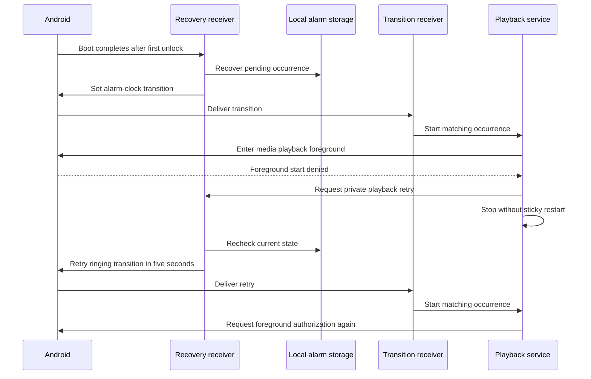

# Alarm audio when the default sound is unavailable

Reader: The Android alarm maintainer.
Action: Preserve audible attempts, cancellation, and sound rehearsal when changing playback.

Curfew attempts the device's default alarm sound, then a bundled sound if the
preferred sound cannot load or start. The platform ringtone API can return
without a local audio track when its default provider is unavailable. A single
unchecked play call therefore cannot establish audible execution. The CI
failures reached durable ringing state and notification presentation while
failing the audio observation. Platform logs also reported unreadable default
alarm URIs. These are separate facts; notification delivery does not prove sound.

The app owns a `MediaPlayer` for both the preferred and fallback sound. It uses
`USAGE_ALARM`, loops the source, and leaves volume and routing to Android. File
descriptor lookup runs on an I/O dispatcher. Player creation, asynchronous
preparation, playback, and release stay on the main dispatcher. The decoder has
a three-second preparation timeout. Cancellation closes descriptors even when
a provider finishes opening after the request stops.

The playback session stops a failed candidate before trying the fallback.
Generation checks prevent a late load or confirmation from resurrecting a
stopped alarm or disturbing a newer sound. Leaving ringing cancels an in-flight
startup. Audio-focus loss releases the sound; gain makes a new playback attempt.
The occurrence's ringing boundary does not move when playback restarts.

The bundled `sunrise_fallback.wav` is an original Curfew synthesis. It contains
four alternating 660/880Hz pulses in a two-second loop. It uses 22,050Hz mono
16-bit PCM with short attack/release envelopes and a peak amplitude of 14,000.
Run `python3 -B scripts/generate-fallback-alarm.py` to regenerate it. The asset
requires no third-party media license, network, runtime generation, or additional
Android permission. It does not override the device's alarm-stream volume.

Sound rehearsal uses this same path and stops two seconds after playback starts.
The owner must still confirm hearing the sound. A playing track, fallback choice,
or timeout never writes a hearing confirmation automatically.

`AlarmSoundPlaybackTest` covers default preference, fallback, dual failure,
cancellation, stopping during load/confirmation, and ownership across overlapping
requests. `AlarmSoundFallbackInstrumentedTest` checks actual bundled playback
from an unreadable preferred URI and the bounded rehearsal. The existing audio
probe now exercises Curfew's default-or-fallback contract rather than requiring
the platform's raw ringtone provider to work. The known-PCM probe remains as an
independent decoder/output check. The schedule-to-authenticated-release journey
still requires an actual alarm audio track and its eventual stop.

Installed and physical acceptance remain separate from compilation and host
checks. An active audio track does not establish perceived sound, sufficient
volume, DND behavior, headphone routing, or manufacturer battery handling.
The completed default-policy Doze observation used the earlier installed APK
and cannot verify this replacement. No schema, account, wire, or signing change occurs.
Rollback restores the prior player without changing saved occurrences.

Sources: [Android MediaPlayer](https://developer.android.com/reference/android/media/MediaPlayer)
and [Android Ringtone](https://developer.android.com/reference/android/media/Ringtone).

Resource ownership also covers the interval after preparation while descriptor
cleanup suspends. The player remains under the preparation function's cleanup
until the caller can accept it. Cancellation in that interval releases the
prepared player. Host suites, both app/test APKs, and both lint variants pass
again after that cleanup refactor (`audio-resource-checks.txt`, 50s).

## Playback denied during boot recovery

Android 15 and later restrict media playback services started from boot.
The API 36 reboot fixture reproduced rejection even after a one-second
AlarmManager handoff. Its platform log retained BOOT_COMPLETED as the
foreground start reason. The image grants a 20-second boot exemption, and
AOSP retains the longer existing temporary allowlist entry. These observations
suggest that a following alarm-clock exemption can retain the boot reason.
They do not establish that all exact-alarm starts are forbidden.

When foreground entry is denied, the service stops without entering a crash
restart loop. Its private recovery receiver reloads durable pending state and
sets another alarm-clock transition five seconds ahead during a ringing phase.
The next transition again checks saved state. Quiet and terminal states never
become ringing because a start was denied. The retry does not change the
occurrence identity, attempt, or ringing boundary. It requests no additional
permission and changes no Android policy setting.

The sequence diagram shows the local retry after Android rejects foreground
entry. Android controls foreground authorization at every attempt.

Sources: [Android 15 foreground service restrictions](https://developer.android.com/about/versions/15/changes/foreground-service-types)
and [AOSP temporary allowlist implementation](https://android.googlesource.com/platform/frameworks/base/+/refs/heads/android16-release/services/core/java/com/android/server/am/FgsTempAllowList.java).
