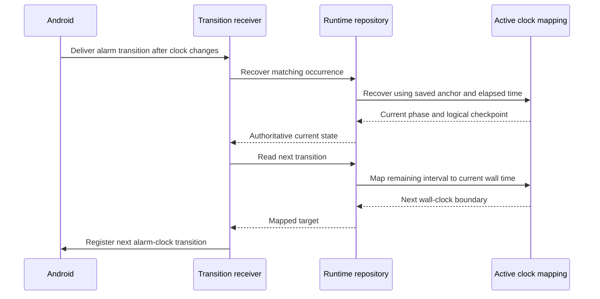

# Keep active alarm intervals independent of wall-clock changes

Reader: The Android alarm maintainer.
Action: Preserve elapsed ringing and quiet intervals when changing recovery, polling, or alarm scheduling.

Future alarms follow the owner's local date and time. Once an occurrence is
ringing, the current boot's elapsed clock controls its cadence. Moving the
wall clock must not skip an attempt, silence a current attempt, or stretch a
quiet interval. A new boot uses wall time because the old elapsed origin no
longer applies. Before-first-unlock ringing remains unsupported.

The installed regression moved the clock five minutes forward during the
first attempt. The previous runtime advanced to the second quiet interval
and stopped audio. Fixing only the transition receiver was insufficient:
callback polling also advanced the engine using wall time and reproduced
the failure at a later poll. Both paths now call the same runtime recovery
method. Playback restoration and lifecycle recovery use the same clock rules.

## Persist the active anchor

`persistedAtWall` and `persistedAtElapsed` form a clock anchor. For an active
occurrence, the next checkpoint advances that anchor by elapsed time. It does
not replace the logical anchor with the newly changed wall time. Otherwise,
a second recovery would reintroduce the clock jump. This private storage
field is not an audit write timestamp.

Scheduled occurrences use current wall time. A newly started occurrence or
a new boot establishes a new anchor. Terminal outcomes have no next
transition. The existing JSON protocol fields and Room schema remain unchanged.

## Map remaining time to Android

Alarm-clock registrations use wall time. The runtime computes the remaining
logical interval, then adds it to current wall time when registering the next
transition. The phase's original start and end remain unchanged in stored
state. The quiet screen uses that mapped time for its next-ring label.
Receipt expiry and authentication still use wall time; the playback clock
must not become a new authority for accepting release proof.

This sequence diagram shows a transition delivered after a wall-clock jump.
The runtime rechecks the occurrence before scheduling its next boundary.

Transitions use foreground broadcast delivery. Their local work finishes
before optional network publication. A service that already entered the
foreground retains its ringing notification while processing another command;
it does not replace that notification with a startup placeholder.

`AlarmRuntimeClockTest` covers forward/backward clock changes, new boots,
checkpoint continuity, occurrence isolation, and scheduled/ringing/quiet/
terminal deadlines. `scripts/accept-clock-emulator.py` changes only the owned
API 36 emulator, requires the first attempt to remain audible, and checks
that quiet begins at the original two-minute elapsed boundary. Cleanup
removes the controlled occurrence and restores automatic time settings.
The native quiet-screen case checks presentation from a saved clock anchor.
Emulator audio evidence does not establish physical speaker output.

Rollback restores the prior clock behavior without a schema migration.
Correct the device clock and use deliberate recovery for any pending
occurrence before downgrading to a build that lacks these clock rules.

## Foreground relaunch recovery

Force-stop removes Android alarm registrations and playback. On the owned
API33 emulator, reopening previously left a saved Ringing occurrence silent.
MainActivity now requests the existing recovery path when the playback
service is absent. The service tracks only its local lifecycle; that flag is
not proof of audio or release authority. Reopening while the service is alive
does not request another recovery. Saved-state checks and exact-alarm access
still govern the five-second alarm-clock retry.

The external relaunch driver first reproduces the failure without manually
starting a service. The corrected API33 run restored actual alarm audio with
a new process, the same occurrence, attempt 1, and original boundaries. The
fixture's finally block removed the controlled occurrence. Newer-platform
behavior and physical speaker output remain separate evidence.
