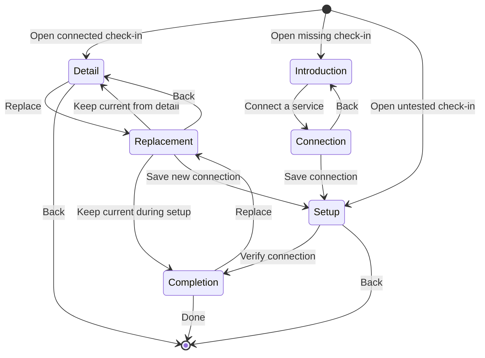

# Curfew Android product and interface design

Reader: Curfew's Android designer and maintainer.
Action: Implement and review the complete local Sunrise experience before accepting P1.
Status: The native replacement is in progress. The older configuration scroll is not the accepted product design.

Consumer launch is blocked on a usable approval method. The current check-in
integration needs an operator running a compatible HTTPS service. Curfew does
not provide that service. A cleaner form does not resolve this prerequisite.
The [check-in correction](superpowers/plans/2026-10-21-check-in-prerequisites.md)
records the supported flow and the missing consumer path. Earlier visual
reviews establish rendering only; they do not establish consumer usability.

Curfew supplies the cream, ink, ember, Calistoga, Hanken Grotesk, and horizon identity. Material 3 Expressive supplies the native controls, shapes, type roles, motion, and interaction conventions. Use official Material Symbols Rounded. Do not draw substitute platform icons or recreate native controls to make a browser mockup look Android-like.

The replacement uses Material 3 `1.5.0-beta01` and its required Compose `1.12.0` dependency line. The stable Material 3 `1.4.0` artifact keeps Expressive APIs internal. The public beta therefore replaces the old baseline rather than bypassing Kotlin visibility. Its compile SDK is 37; minimum and target SDK decisions remain separate. Build and installed checks must cover both distributions after this dependency change.

Use the shared Curfew design roles from `curfew/landing/public/design/tokens.css`. Fill the Android color roles rather than retaining unassigned stock colors. Use the brand by default. Wallpaper colors require an explicit user choice; the app currently exposes no such choice. Keep platform type sizing, locale, screen-reader semantics, focus, reduced motion, and system insets.

## Screens and tasks

Daily use centers on the saved time, seven visual alarm days or one-night date, the on/off control, and the named wake check. Group the time, days, and switch on one tonal surface. Give the check-in its own row. Do not add a status dashboard or explain each visible control in a paragraph. Let the switch show ordinary on/off state without a separate status row. An enabled schedule with missing readiness says “Needs attention” and retains its setup repair action. The switch records the owner’s choice; it cannot establish that Android can deliver the alarm.

Alarm editing uses native time and date controls and one Save action. Keep a draft until Save. Back cancels changes. Show the actual next occurrence in the user's locale. A completed one-night alarm does not become a recurring alarm. Future edits and toggles cannot dismiss an active occurrence.

First setup handles required access, an audible channel, a real sound check, and the wake check in focused steps. Show the current blocker and its next action. Keep Android enforcement limits accurate. A notification or stored test flag does not prove that the person heard audio.

Copy names the task, current state, or action. Do not narrate the layout, describe visible controls, or repeat a heading in supporting text. Keep guidance only when it explains a prerequisite, consequence, recovery step, or non-obvious choice. Expose destination names to assistive technology through pane and heading semantics instead of adding visible labels.

Check-in setup belongs in its own destination. The current P1 HTTPS implementation generates and exports a private setup file for the trusted operator, then tests an authenticated response. It is an integration path, not a consumer-facing endpoint form on the daily alarm screen. The browser proposal's QR and verifier-issued import are not implemented capabilities. Do not advertise them until they work. Account setup remains separate and optional.

During ringing, show the chosen alarm time and named wake check. Give the check-in action priority. Quiet intervals still represent an active alarm. Lost connectivity does not stop the saved alarm or establish success. Do not offer ordinary dismiss or snooze. A verified current approval stops only its occurrence.

[Alarm recovery](OWNER_RECOVERY.md) is a separate deliberate task. It requires a reason, a three-second confirmation, and fresh Android screen-lock authentication. It records an override without calling the check-in complete. Keep the reason after cancellation or failure. Show visible progress and an equivalent keyboard and assistive-technology path.

P1 is local Sunrise. Multi-device release belongs to P1b. Bedtime Curfew remains a separate required MVP capability. Do not imply that this alarm completes the Android MVP.

## Adaptation and review

Compact screens show one focused task. Expanded screens may show a related saved-alarm summary beside its editor. Do not distribute unrelated permissions, account forms, and integration details into columns. Keep ordinary controls at least 48dp, and retain meaningful labels when using visual day indicators.

Respect keyboard and system insets. Keep every action reachable on short windows and at 200% text. Retain native 12/24-hour and date formatting, RTL navigation, predictable Back behavior, and focus order. Honor reduced motion without shortening an authorization requirement.

Review rendered daily, editing, setup, active, quiet, offline, rejected-check, recovery, cancellation, and storage-error states in both themes. Check 360dp phones, short windows, expanded layouts, and enlarged text. Judge whether the complete workflow makes sense as well as whether each screen fits. Source changes, a successful render, and passing tests alone do not establish product quality.

Sources: [Material 3 Compose releases](https://developer.android.com/jetpack/androidx/releases/compose-material3), [Material theming](https://developer.android.com/develop/ui/compose/designsystems/material3), and [Android adaptive layouts](https://developer.android.com/develop/adaptive-apps/guides/canonical-layouts).

## Remaining native review findings

The daily time measures the numeric value and localized AM/PM separately.
They share a baseline when both fit without reducing the time's hierarchy.
The period moves below when width or text size requires it. Weekday markers
keep a visible gap and grow around enlarged labels. Recurring alarms show
only their selected days. One-night alarms keep their chosen date. The saved
check-in name needs supporting status only when its connection is unresolved.

The schedule editor uses Material time/date controls inside a bounded Curfew modal. Normal time selection uses the dial and official keyboard toggle. Keyboard entry uses the same standard numeric fields and localized AM/PM choices at every width, so resizing preserves raw input. An invalid value disables Done and the dial toggle. Date input replaces the calendar when it cannot fit. The date component owns its body inset; the modal does not double it. The mode action sits with Cancel and Done instead of consuming an empty calendar header. The body scrolls independently of Cancel and Done, and the window respects the keyboard. Cancel, Back, and a backdrop tap discard picker changes. Done changes only the editor draft; Save persists the schedule. Date-picker milliseconds represent UTC calendar days, independent of the phone timezone. [Picker verification](TESTING.md) records actual device-profile evidence.

The sound test uses one confirmation dialog after playback starts. It asks “Did you hear the alarm?” and offers “I heard it,” “Play again,” and “Not now.” Failed playback cannot offer hearing confirmation. The sound action remains available after setup. [Sound-check behavior](SOUND_CHECK.md) defines cancellation and the old-flag correction.

Compact task app bars keep one title line and use an ellipsis when enlarged text cannot fit. The full task name remains available to accessibility. Titles must not paint over content below the app bar. Dialog visual fixtures use the actual device's font scale because a local density override outside the separate dialog window is ineffective.

## Daily screen composition

Keep the alarm and its check-in together below the app bar, with a 12dp gap
between their surfaces. Do not center this short group in the whole viewport.
The centered capture separated the alarm from the brand and only moved the
empty area above it. Do not stretch controls or add copy to fill the phone.
Limit the daily column to 420dp on expanded windows. Settings and account
forms keep their 640dp limit. Setup can use two adaptive panes.

Give the chosen time visual priority. Its numeric size can reach 100sp when
width permits. Fit the time and localized period by measurement; narrow windows
and enlarged text must retain readable values without clipping. The alarm
surface uses 12dp vertical padding and 12dp gaps. The time and switch share
one row. Reserve a separate status for missing readiness or a completed
one-night alarm. Keep the time dominant while fitting its size to both available width and
height. Setting rows have a 56dp
minimum and grow around their content. Keep top-aligned scrolling on short
windows, during setup, and with enlarged text.

The layout tests check time hierarchy, top alignment on short and enlarged-text
screens, weekday separation, one-night dates, and proximity between the alarm
and check-in. Review native captures at 320/390dp and 100/200% text in both
themes. A geometry check alone does not establish visual quality.

An explicitly selected one-night date stays fixed when the time changes.
An inferred date continues to follow the next occurrence until the owner picks
a date. A saved one-night alarm loads as an explicit choice. This draft marker
survives the editor's saved state and does not add another visible control.

Ordinary form actions follow their fields. The ringing screen keeps its
separate action area. The review page has no empty notes column.

The editable daily time exposes the stored occurrence's local date and time
as its accessibility state. Use the occurrence instant rather than the
editable schedule time because an active occurrence or a DST adjustment can
differ from future settings. The weekly surface keeps its visual day markers;
this accessibility value adds no visible date label or extra row.

The device-limit acknowledgement tells the owner to unlock the phone after
restarting. This is an observed alarm availability limit, not explanatory
copy about the interface. It appears before acknowledgement alongside the
existing power, force-stop, and battery-policy limits.

## Alarm language

Keep Sunrise as the product capability name in planning and implementation.
Use “alarm” for ordinary actions, destinations, and status in the app.
The daily time announces “Edit alarm” and its stored occurrence; the native
switch announces “Alarm” with its own checked state. The editor title and
expanded navigation use the same noun. Quiet intervals retain “Time to get
up.” with the next ringing time rather than another feature-name heading.
Do not add a second visible title or explanatory row to achieve this.

Check-in introduces the release purpose and the compatible-service prerequisite
before asking for an address. The optional opening link stays under Optional
details and receives validation feedback when invalid. Recovery
cancellation reports cancellation without claiming that a concurrent wake
approval has not stopped the alarm. Errors identify the failed action.
This copy pass changes no authorization or schedule behavior.

An unchanged connected detail uses the app bar's Back action. Show Done only
when finishing setup. Preserve that completion intent through a canceled
replacement; a successful replacement starts a new setup. Connection errors
and file-save outcomes remain visible even when the current connection is
verified. Do not repeat authoritative Connected state in another success row.
Explain the setup file's authority to stop the alarm rather than its signing
mechanism. The Android document action says Save setup file.

This state diagram distinguishes configuration completion from ordinary viewing.

## Scaled windows

Task gutters use 16dp below 360dp and 24dp otherwise. Repeat choices wrap
as whole chips when they cannot share a row. Do not reduce the owner's text
size to retain a fixed arrangement. The brand and task titles use one line
with ellipsis; accessibility retains their full names.

Setting rows give the saved name priority over a decorative leading icon.
When the row width divided by text scale falls below 180dp, omit that icon.
Keep the chevron, full-row action, and unchanged text size. This avoids
splitting a normal word such as “Morning” across lines at 240dp/200% text.

## First use and navigation

The first launch uses the home page’s cream canvas and continuous sun/horizon
composition. It introduces bedtime and waking up with one wordmark, one headline, one
commitment, and two choices. The same introduction and action components stack
on phones and share two adaptive panes on wider windows. Each pane scrolls
when enlarged text needs space. Separating hinges divide meaningful content
rather than cutting through controls. The background stays continuous. The logo grows with readable pane width and
available height, rather than switching between fixed device sizes.

Every connected Android device must enforce its owner’s commitments locally.
Android is not a remote-only controller. This P1 implementation still covers
local Sunrise; bedtime enforcement and coordinated network actuation require
separate acceptance. Both Compose surfaces and native windows follow the
device’s light/dark setting while retaining Curfew’s palette.

Wake time, service connection, required Android access, sound rehearsal, and explicit
activation form one flow. Continue saves a draft without enabling it. Saved
alarms skip the introduction. Settings offers Alarm setup for later repairs;
the page shows the current missing action and its purpose.

The shell uses Jetpack Navigation 3 and a Material 3 Expressive top app bar.
Settings is a tonal icon action on the main screen, with Back on task screens.
Shared wake-time bounds connect the alarm, editor, and review. The Android system splash uses the
Curfew canvas and animated horizon without an artificial wait. Android owns
splash dismissal; the app does not request a copied splash view for an extra
exit fade. The activity explicitly resizes for the keyboard so Android does
not pan task navigation off screen. See
[the first-use design and remaining service gap](ONBOARDING_DESIGN.md).

## Main-screen navigation correction

The owner opens Settings from a tonal icon action in the daily top app bar.
Settings is a task with Back navigation. The app has one main destination,
so a two-item bottom bar or rail adds structure without useful navigation.
Do not invent a third destination. Keep Navigation 3, shared transitions,
system Back, the established brand, and adaptive content layouts.

The navigation regression checks the Settings action above the alarm content,
the absence of the former Alarm tab, and return without saving editor changes.
The responsive run captures daily, Settings, editor, and account screens.
The correction changes presentation only. Physical alarm acceptance remains
separate from the emulated UI matrix.

The daily clock now fits both available width and available height. Its height
budget leaves room for the one-night date or repeat markers and the complete
check-in row in a short window. The same component grows on taller windows;
it does not create another phone-or-tablet layout. Enlarged text retains a
readable minimum and the page can scroll.

The editor keeps all seven repeat controls on one row when their 48dp touch
areas fit. Narrower content uses four days followed by three rather than
leaving Sunday alone. Permission buttons center each wrapped line at 200% text.
These changes preserve the existing colors, shapes, navigation, and alarm state.

## October 21 setup layout and navigation

The current setup behavior is in [ONBOARDING_DESIGN.md](ONBOARDING_DESIGN.md).
Setup uses a flexible purpose/work arrangement. It stacks on narrow windows
and separates into meaningful panes on wider windows and separating hinges.
The 640dp form limit continues to apply to settings and account content.

Check-in introduces the service prerequisite before exposing its connection
address. Optional details contain the name and opening link. A verified
replacement cannot rename or rebind an existing alarm until the owner saves
that alarm. Back never advances through completed permissions.

Shared wake-time bounds connect the main screen, editor, and review. The
connection summary shares bounds with review when those destinations are
adjacent. Other destination changes use the Material Expressive motion scheme.
The task header moves beside the connection field when a short keyboard window
cannot fit both vertically. The header appears once.
