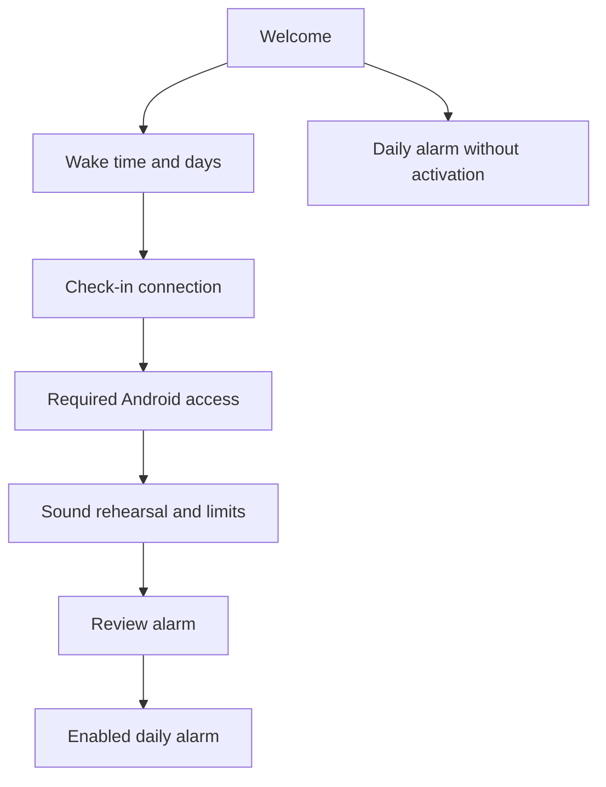

# Android first-use setup

Reader: The Curfew Android designer and maintainer.
Action: Verify the implemented flow and keep the remaining service work separate.
Date: October 20, 2026.
Status: The flow and responsive welcome pass CI verification and the complete native screenshot review. Physical acceptance and the consumer service remain open.

A new owner sees Welcome before access requests or an empty alarm screen. The
owner chooses a wake time, connects a check-in, grants required Android access,
checks the sound, and explicitly turns on the alarm. Continue saves a separate
draft. It cannot schedule an alarm.

## Product intent and Mac alignment

Curfew enforces a choice made ahead of time. The Mac's first-run sequence puts
schedule choices before permissions and explicit activation. Android follows
that commitment model for bedtime and waking up. A connected Android device
is an enforcement endpoint in the Curfew network. It must carry out its owner’s
plans on that device. Sunrise is one capability within this broader product. It keeps the cream and ink surfaces,
ember actions, horizon mark, Calistoga display type, and Hanken text roles.
Android uses native Material 3 Expressive controls and Material Symbols.

The implementation does not copy the Mac's desktop wizard frame, repeated step
titles, seven-day review prose, extension budget, or remote-only choice. The
selected days already communicate recurrence. Accounts remain optional in
Settings. The app does not advertise bedtime lockout or cross-device release
as implemented features of this P1 flow.

The old Android first-use screen exposed an empty alarm, a separate checklist,
and a Save action that required readiness and enabled the schedule. Reordering
that checklist would have kept the activation problem. The new flow separates
preparation, verification, and activation.

## First-use sequence

This flow diagram shows destinations at one level of abstraction.

The app skips requirements that are already satisfied. Back preserves the
previous task. Repeated repairs return to the existing destination instead of
accumulating duplicate route keys. Completing the last readiness requirement
moves to Review without another first-use success checklist.

### Welcome

Welcome introduces both bedtime Curfew and morning Sunrise. The headline is
“Your nights. Your mornings.” The supporting copy is “Wind down on time. Wake
up when you planned.” The actions are Get started and Not now. There is one
wordmark, one introduction, and one commitment/action group. Neither action
enables an alarm or grants access. The introduction choice persists separately
from readiness and schedule state. Existing saved alarms bypass Welcome.

The same components change placement as the window changes. In paired layouts,
the symbol and wordmark grow together with readable pane width and available
height. Their growth is continuous and bounded. Compact portrait phones and
short windows retain the compact treatment; enlarged text reduces available
space before any brand enlargement. A narrow window
stacks the introduction above the shared sun/horizon scene and commitment.
It measures the scene and actions first, then centers the introduction in the
remaining height. Enlarged text can expand the composition into its existing
scroll container. The layout does not pin the headline to the top or add a fixed
top spacer.
Wider windows place the introduction and commitment next to each other with
Material 3 Adaptive 1.3.0's SupportingPaneScaffold. The background remains one
continuous scene. The app adds no second title, duplicate description, or new
feature selector to fill space. Enlarged text can scroll within a constrained
pane while the other pane remains usable.

The production layout reads currentWindowAdaptiveInfoV2, including Android's
posture and hinge bounds. Material's pane scaffold keeps book-mode content on
opposite sides of vertical hinges. For a separating horizontal hinge, the app
uses the reported upper/lower regions for introduction and commitment. The
current pane scaffold does not itself partition those horizontal hinge regions.
Each region has useful content, and no text or action crosses the hinge. The
cover display retains the complete narrow layout. A resized or folded window
keeps the existing entrance state and renders one instance of each section.

The surface extends behind the navigation bar while controls respect its inset.
A one-shot entrance uses the current Material 3 Expressive motion scheme. The
wordmark appears first, the copy follows after 45ms, the sun rises behind the
horizon after 80ms, and the actions settle after 120ms. Spatial motion uses the
scheme's default spring; opacity uses its fast effects spec. Controls remain
usable during the entrance. System-disabled animators show the final composition
immediately. Compose handles the system duration scale for enabled motion.
The app adds no looping animation or wait before continuing.

This P1 flow currently opens wake-time setup after Get started. Bedtime setup
and coordinated actuation remain separate work. The welcome describes Curfew's
whole purpose without displaying controls for unimplemented capabilities.

### Wake time and days

The owner uses the native time picker and visual day controls. One-night and
weekly choices retain the existing locale, 12/24-hour, timezone, and DST rules.
An explicitly chosen one-night date does not change when the time changes.
The initial draft remains 7:00 AM for one night. The app does not silently
choose a repeating schedule.

Continue persists the validated time/day draft before advancing. A failed write
keeps the editor and offers retry. Uncommitted field edits survive the current
navigation entry and Android saved-state restoration. The durable cold-start
draft is the last draft the owner committed with Continue.

### Check-in connection

The check-in determines when the alarm may stop. The current P1 implementation
requires a service that supports Curfew's authenticated HTTPS verification.
The owner enters its details, exports the private setup file to that service,
and tests the connection. The setup file grants release authority. It must not
appear in ordinary logs or inline diagnostics.

A successful connection test establishes a usable authenticated connection. It
does not establish that tomorrow's wake condition is met. Failed, unavailable,
pending, invalid, or expired responses cannot complete verification. Returning
to an already verified connection during setup still offers Continue.

This integration remains the principal consumer product gap. There is no
first-party keyholder invitation, QR enrollment, paired offline code, or hosted
wake challenge to offer. Calling an endpoint a service address cannot solve
that gap. A separate consumer-service project needs a real enrollment contract.
Owner recovery remains a separately authorized escape path.

### Android access and sound

The page shows the current missing prerequisite, its purpose, and one main
action. It does not list seven equally weighted rows or repeat Complete labels.
The Settings entry is Alarm setup. The individual task supplies its heading.

| Requirement | Heading | Main action |
| --- | --- | --- |
| Exact-alarm access | Ring on time | Allow exact alarms |
| Notifications | Show alarm notifications | Allow notifications |
| Full-screen access | On your lock screen | Allow alarm screen |
| Muted channel | Allow alarm sound | Check alarm sound |
| Zero alarm volume | Turn up the alarm | Turn up alarm volume |
| Hearing confirmation | Check the sound | Test alarm sound |
| Platform limits | Keep your alarm available | I understand |

Android 14 and later use the package-specific full-screen intent Settings
page. The app checks the actual capability on return. Opening Settings does
not complete a requirement. Denial keeps the same task available. An existing
active alarm retains its audio and notification fallback after access is
revoked. A new-setup gate cannot dismiss an active occurrence.

Rehearsal remains cancelable and stops on exit. The app does not silently alter
volume or Do Not Disturb. An audio track starting does not establish hearing.
Only explicit confirmation after successful playback completes that requirement.
The platform-limits task discloses the need to unlock the phone after reboot.
Power-off, force-stop, uninstall, DND, and manufacturer policy remain limits.

### Review and activation

Review shows the chosen time, selected days or one-night date, and named
check-in. The time/day summary returns to editing. It does not repeat these
values in explanatory paragraphs. Turn on alarm is the only activation action.

Activation rechecks current access and the verified connection. A past one-night
draft remains an error and offers editing. Registration or persistence errors
keep Review available. Navigation waits for the saved enabled schedule before
showing the daily alarm. The daily time, days, switch, and check-in show the
result without a congratulations screen.

## Persistence and recovery

The first-use DataStore stores the introduction choice and a validated local
schedule draft. It does not store service secrets or Android grants as completed
booleans. The existing secret store retains private service configuration.
Malformed draft fields decode to unfinished setup, never to an enabled alarm.

Cold startup resumes a committed draft at its next unmet requirement when
setup was started. An explicit Not now opens the daily screen on later launches
while retaining the draft for deliberate continuation. Existing
alarms open normally and receive targeted repairs. Active ringing or quiet
occurrences take priority over onboarding navigation.

First-use reads expose Loading, Ready, and Error states. An I/O or corruption
failure never becomes a fresh installation and never resets preferences. Retry
recollects the same store. Existing saved alarms do not depend on a successful
optional introduction read. The public error offers retry without diagnostics
or a destructive reset.

## Device appearance

The shared CurfewTheme reads the device's current light/dark setting. Native
window themes now select matching light and dark parents, canvas colors, and
brand accents. The earlier native parent was fixed to light even when Compose
used dark colors. Android's automatic force-dark does not recolor Curfew's
explicit palette. The launch screen uses its night-qualified canvas and horizon.
System bars use the platform's automatic light/dark treatment. Brand colors stay
consistent within each mode; wallpaper colors are not enabled implicitly.

## Native navigation and motion

The shell uses Jetpack Navigation 3 1.2.0 with a saved back stack and per-entry
state. The main screen uses Material 3's top app bar with an Expressive tonal
Settings icon button and a native tooltip. Settings and focused tasks retain
Back navigation. The app has one main destination, so it has no bottom bar
or rail. Adaptive content and shared transitions remain independent of navigation.

Navigation entries read current Compose state and callbacks. They must not
retain permission values, save errors, or service callbacks captured when the
entry first opened. Native regressions cover both stale values and stale
connection callbacks.

Compose SharedTransitionLayout and Navigation 3's animated-content scope
connect the wake time between daily, editor, and review. Ordinary destinations
and predictive Back use Navigation 3 transitions. Compose observes the system
animation scale. The platform splash exit also checks whether animators are
enabled.

AndroidX core-splashscreen 1.2.0 supplies the system launch screen. It uses the
Curfew canvas and animated horizon in light and dark themes. It does not add a
second splash Activity or a minimum wait. The splash cannot wait on state
delivered through Compose: that stalled installed Activity tests before
correction. Native in-app progress handles unfinished reads, and errors offer
retry.

These choices follow Android's official guides for
[adaptive navigation](https://developer.android.com/develop/ui/compose/layouts/adaptive/build-adaptive-navigation),
[Navigation 3](https://developer.android.com/guide/navigation/navigation-3/basics),
[shared elements](https://developer.android.com/develop/ui/compose/animation/shared-elements/navigation),
and [splash screens](https://developer.android.com/develop/ui/views/launch/splash-screen).

## Verification and remaining acceptance

Failing-first evidence includes absent draft/persistence/review contracts,
focused access assertions against the old checklist, the old launcher theme,
stale connection callbacks, the competing sound action during permission setup,
and the missing continuation for a verified check-in. The installed Activity
suite also exposed the splash stall before correction. Exact final automated
and visual results belong in [TESTING.md](TESTING.md).

The following requirements remain separate from local implementation:

- [ ] Accept the connected Pixel's complete first-use path after installing this candidate.
- [ ] Complete manual TalkBack and reduced-motion review.
- [ ] Finish the remaining physical recovery and presentation acceptance in [P1_ACCEPTANCE.md](P1_ACCEPTANCE.md).
- [ ] Design and ship consumer check-in enrollment before describing the integration as turnkey.

The Mac references are GettingStartedModels.swift and GettingStartedView.swift
in the Curfew repository. The Android behavior builds on the existing schedule,
readiness, verification, and [owner-recovery contracts](OWNER_RECOVERY.md).
