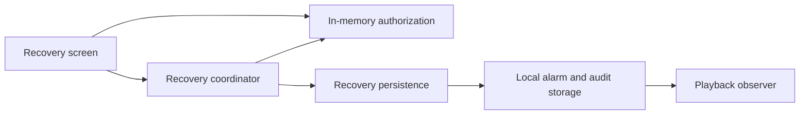

# Stop a local Sunrise alarm through owner recovery

Reader: The Android maintainer delivering Sunrise P1.
Action: Implement and verify the complete recovery path before accepting P1.
Date: October 19, 2026.
Status: Authorization, persistence, migration, and isolated native screen checks passed. The ringing-to-credential integration and whole-app acceptance remain incomplete.

Recovery stops the current phone's alarm without claiming that its check-in succeeded. It requires a trimmed reason of at least 50 characters, a three-second confirmation, and fresh Android screen-lock authentication. Curfew records an Overridden outcome and the reason in one local transaction. It does not send a wake-success receipt or release another device.

## Authorization

Use the platform BiometricPrompt with DEVICE_CREDENTIAL as its only allowed authenticator. Check that the device has a secure screen lock before offering confirmation. The USE_BIOMETRIC normal permission allows the platform prompt; this flow does not request fingerprint or face authentication. Android retains the user's PIN, pattern, or password. Curfew does not receive or store it.

The hold uses elapsed time. An early release cancels it. Keyboard and assistive-technology users receive an equivalent three-second confirmation with visible progress and cancellation. Entering a reason alone has no authority. The Android callback must match the in-memory request identity, arrive within five minutes, and report successful credential confirmation. Cancellation, a clock reset, another request, activity recreation, or process death cannot turn into approval. A completed request cannot be reused.

The screen names the current check-in and preserves the reason after cancellation or storage failure. It keeps the action reachable above the keyboard and at enlarged text sizes. It uses Curfew's colors and typography with Material 3 Expressive controls. It does not add ordinary dismiss or snooze.

## Persistence and playback

This component diagram shows modules inside the Android app.

The coordinator must re-read the requested occurrence after Android confirmation. Recovery accepts only Ringing or Quiet state. A completed wake approval keeps its result. A future alarm or another occurrence cannot be recovered through the old request. The transaction commits the override and its audit together. A failed audit write rolls back the override, so playback stays active. The service observes only its own saved occurrence; the coordinator must not issue a generic stopService call.

After commitment, cancel the matching transition and callback work, consume the matching saved occurrence, and attempt to schedule the next morning. Failure to schedule tomorrow must not change the recorded result or report that today's recovery failed.

The audit stays in app-private local Room storage. It contains the request ID, occurrence ID, reason, and confirmation time. It is excluded from Android backup by the existing app backup policy. Do not log reasons or publish them through optional account synchronization.

## Verification and release impact

Ten host tests cover the hold, reason, cancellation, expiry, callback identity, and single-use authority. Five completion tests preserve storage-before-cleanup ordering, accurate rescheduling failure, and cancellation handling. Installed tests cover the terminal outcome, audit, race with verified waking, rejection of future alarms, and transaction rollback. A migration test must prove that schema 1 alarms and callback definitions survive schema 2's new audit table. Native credential confirmation, accessibility, keyboard behavior, and rendered layouts need separate installed evidence.

Schema 2 adds a local audit table through an additive Room auto-migration. It changes no wire format. A schema 1 APK cannot open the upgraded database. Rollback therefore needs a compatible build; do not delete the owner's schedules or downgrade destructively. Reject an implementation that permits unauthenticated recovery or stops playback before the audit commits.

The existing remote-override path and first-party delegation are separate. This local recovery path does not implement P1b or replace bedtime Curfew.

Sources: [Android credential authentication](https://developer.android.com/identity/sign-in/biometric-auth) and [Room migration testing](https://developer.android.com/training/data-storage/room/migrating-db-versions). The implementation uses the repository's pinned Room 2.8.4 APIs.

## Clock correction

A local credential confirmation uses elapsed time for the hold and its expiry.
The recovery transaction also accepts an active occurrence whose stored start
is now ahead of the wall clock. Its engine observation cannot predate that
start, but its audit records the actual wall time of confirmation. This keeps
a backward clock correction from trapping the owner in an active alarm and
does not describe recovery as a successful check-in.

The installed regression test
`recoveryStillWorksAfterTheWallClockMovesBehindTheAlarmStart` failed first on
API 36 with `observation predates campaign`. The correction is implemented;
the installed green run passed all six recovery storage cases on API 36.

## Native integration evidence

`AndroidOwnerRecoveryInstrumentedTest` passed its two installed checks on API
36: a device without a screen lock cannot authorize recovery, and the native
prompt permission is declared. The platform adapter allows DEVICE_CREDENTIAL
only and checks the reported authentication type. Those negative checks do
not prove a successful Android credential interaction.

The isolated recovery screen passed all four original cases after its timer
changed to elapsed time. New tests now require foreground cancellation and
hide the reason field until a screen lock exists. Those two tests have not
run yet. The ringing screen now has a separate recovery action and displays
the actual alarm time rather than an attempt counter; its installed rerun
is pending. A UI compilation was interrupted by missing destination components
while the design subagent was replacing the old all-in-one page. That was an
incomplete source snapshot, not installed acceptance evidence.

Once Android has confirmed the owner, completion protects the local commit
and matching-occurrence cleanup from Activity cancellation. Closing the
screen cannot cancel that already-authorized operation halfway through.
Closing or recreating the Activity before confirmation still invalidates the
pending request. The cancellation regression cancels the outer Activity job,
not the protected transaction itself. Process termination remains a separate
installed lifecycle gate; coroutine cancellation protection cannot prove it.
