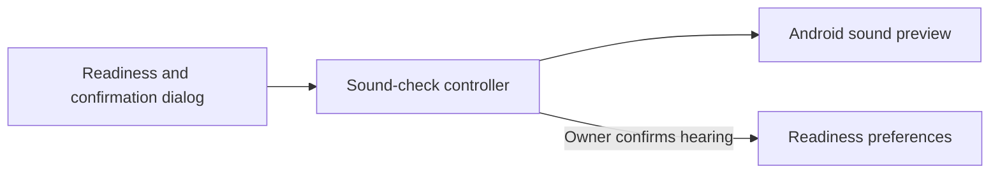

# Confirming alarm sound

Reader: The Android maintainer changing P1 readiness.
Action: Preserve the distinction between starting playback and the owner hearing it.

Curfew records sound readiness only after the owner chooses **I heard it** following successful preview playback. Starting a preview, posting a notification, or observing an Android audio track does not establish that a speaker produced audible sound.

The preview uses the default alarm sound, alarm audio attributes, and a two-second timeout. It falls back to the notification sound only when Android supplies no default alarm URI, matching the ringing service. It does not change system volume. Playback failure offers retry without a hearing-confirmation action. Saving failure does not create a confirmation or discard an earlier one. It permits another save attempt. Canceling through Back or Not now, leaving the app, or destroying its activity stops the preview. A late playback result cannot reopen a canceled confirmation.

The owner can replay the sound from Alarm access and sound after setup. Canceling a later replay preserves an earlier explicit confirmation. No result from this rehearsal releases an active alarm or changes its occurrence.

## Component diagram

This component diagram shows the sound-check modules inside the Android app.

The old `test_sound_completed` preference was set automatically when playback was requested. Curfew now reads `alarm_sound_confirmed` instead. An existing automatic flag does not migrate as hearing confirmation. This preserves schedules and stored outcomes but requires the sound check before setup can claim readiness or schedule another occurrence. An already scheduled alarm retains its existing Android trigger; this migration does not cancel it.

Six host tests cover confirmation eligibility, cancellation, replay, playback failure, and failed storage. Installed tests cover the old preference, actual alarm audio attributes, confirmation, replay after completion, cancellation, and background cleanup. Separate dialog fixtures cover failure states, both themes, and enlarged text. These tests do not replace the required Pixel and non-Pixel speaker checks.

Rollback must preserve this confirmation rule. Reverting to the old automatic preference would falsely mark playback as hearing. The correction adds no permissions, services, wire formats, or account requirement.

The implementation uses Android's [Ringtone API](https://developer.android.com/reference/android/media/Ringtone) for bounded preview playback and explicit audio attributes.
