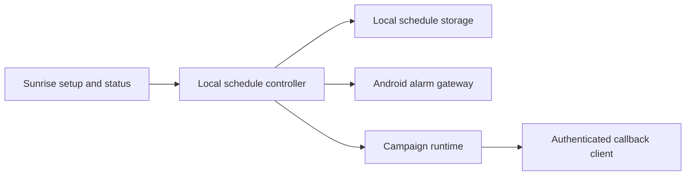

# Sunrise P1 implementation and acceptance

Reader: The Android maintainer implementing Docket project `01M5AXW727EJSE5FM2H8WXJRWS`.
Action: Complete the local Sunrise journey and collect evidence against all four feature tasks before accepting P1.
Date: October 19, 2026.
Status: Implementation started. No feature or device acceptance is claimed.

## Decision

Keep the existing persistent campaign engine, exact-alarm gateway, Room campaign storage, and authenticated callback protocol. Add a durable local alarm schedule above that engine. Curfew accounts and the coordinator remain optional. The saved schedule describes future mornings; the active campaign identifies one morning and keeps its release authority even when future settings change.

Support one saved Sunrise alarm with either a selected one-night date or selected weekdays. The user can edit its time, recurrence, and enabled state. Disabling future alarms does not dismiss an occurrence that has already begun. The UI shows the saved next occurrence and the active condition. Ringing keeps the existing two-minute ring and one-minute quiet defaults; configuration of engine internals belongs outside the normal nightly flow.

Follow device-local time for future occurrences. Retain the resolver's existing DST behavior: a gap uses the first valid instant and an overlap uses the first offset. An occurrence already underway retains its identity through clock changes and recovery. Repeated delivery of a scheduled occurrence must not reset its active state. A completed one-night occurrence must never become tomorrow's recurring alarm.

The release verifier must have a usable shared-secret provisioning path. Merely saving a URL and generating an inaccessible secret is incomplete. The setup UI must display success only after persistence succeeds and expose supported provisioning without logging secrets. An unavailable verifier leaves the alarm active. Emergency owner recovery records an override rather than a verified wake.

## Component diagram

This component diagram shows modules within the Android application. The schedule controller coordinates future occurrences. The existing campaign engine governs active ringing and release.

## Implementation sequence

### P1.1: Durable schedule and armed state

- [ ] Run the existing plain unit suite before changes.
- [x] Add failing schedule tests for a one-night date, selected weekdays, disabled state, next-day recurrence, DST gap/overlap, and stable occurrence identity across recovery.
- [x] Add `alarm/SunriseSchedule.kt` for local schedule selection and deterministic occurrence identity. Keep it independent of Android so these cases run as host tests.
- [x] Add a tested controller that replaces only future scheduled state, rejects incomplete readiness/release configuration, preserves active state, and does not duplicate an occurrence on repeated reconciliation.
- [x] Persist the schedule locally and wire it to setup, armed-state display, transition delivery, and recovery. Add persistence and Compose instrumentation coverage.
- [x] Run targeted tests, then the full plain unit suite before accepting the behavior.

### P1.2: Persistent audible execution

- [ ] Audit playback, notification fallback, audio focus, and service redelivery against the saved authoritative campaign.
- [ ] Reproduce each missing behavior in a failing unit or instrumented test before changing production code.
- [ ] Restore an active alarm from saved state without invented campaign parameters or a silent interval until the next attempt.
- [ ] Verify the installed locked-screen and denied-full-screen paths on an emulator, and retain physical audio/device checks as separate evidence.

### P1.3: Authenticated release

- [x] Add failing tests for configuration/provisioning, accurate save status, and current-occurrence-only completion.
- [ ] Complete a controlled HTTPS verifier setup using the existing versioned protocol. Never introduce an Android-only wire shape.
- [ ] Verify pending, malformed, stale, future, replayed, wrong-occurrence, and unreachable responses remain active.
- [ ] Verify a valid response stops the corresponding audio and records the outcome. Keep deliberate recovery distinct.

### P1.4: Recovery and acceptance

- [ ] Exercise process death, relaunch, reboot, package replacement, time/zone changes, permission revocation, and offline ringing.
- [x] Run both distribution unit/lint/build checks with at most two Gradle workers.
- [ ] Run installed instrumentation and collect screenshots of the final setup and ringing states.
- [ ] Record a Pixel and a non-Pixel acceptance run, including actual audio, Doze, DND, focus changes, and manufacturer limits. Do not substitute emulator evidence.
- [ ] Update Docket through its connector as Codex, then complete only tasks whose acceptance criteria have direct evidence.

## Verification ledger

The starting revision is remote main `6c7062c`. The primary checkout is diverged and contains unrelated work; implementation uses `codex/sunrise-p1` in an isolated worktree. The shared-cache bootstrap completed. The documented resource checker is missing at `~/.claude/resource-limits/agentctl`; Gradle commands are bounded with `--max-workers=2` and `--no-daemon`.

The initial ADB inventory and mDNS discovery contain no connected devices. Six emulator profiles exist. Physical-device acceptance remains unproven.

The focused host run uses the cached Kotlin 2.4.10 compiler and JUnit 4.13.2 with Corretto 20, targeting JVM 17. It passes 23 tests across `SunriseScheduleTest`, `SunriseSchedulePlannerTest`, and the existing `WakeScheduleResolverTest`. New types first failed compilation because their APIs did not exist. The overdue-disable regression then failed with an actual assertion: the planner returned no occurrence instead of preserving the due morning. That assertion passed after the guard changed. These results prove domain behavior, not Android integration, storage, audio, lint, or an installed build.

`SunriseSchedulePlanner` preserves an active or overdue morning when future settings change, cancels a disabled future occurrence, and carries the completed local date into the next plan. The storage adapter must persist that completed date so a later clock rewind cannot reopen it. The setup screen now uses the saved schedule model. It offers native time/date selection, weekly day selection, and the saved next occurrence. The ringing screen observes persisted campaign state. These integrations have compiled, but installed UI acceptance remains pending.

The pinned Gradle 9.5 distribution finished downloading. The host default Java is 27, so its initial build was stopped before compilation; the first full unit run used Android Studio's Java 25 and cached Gradle 9.6.1. The current run uses pinned Gradle 9.5 with two workers and a 1 GiB heap. An offline probe identified six uncached Android build artifacts. The online run resolved those artifacts. The first full plain unit run with Gradle 9.6.1 passed 95 tests across 22 suites using the pinned DataStore 1.2.1 dependency. A subsequent build compiled production and instrumentation Kotlin before failing on the intentionally absent release-consumption API. The implementation now includes that API. The Gradle 9.5 wrapper run with Java 25 passed: 104 plain unit tests across 23 suites, zero failures and errors, plus app and instrumentation APK assembly. GMS verification, both lint checks, and installed checks remain required.

Protocol tag `v0.3.0` could not be fetched, and a remote tag query for `*0.3*` returned none. CI currently references that absent tag. Local testing uses the existing clean protocol checkout at immutable revision `6f5372d67d074a0a88c13b42499940ed3639936e`; it does not claim a tagged or published protocol release. No wire shapes changed in this work.

## Rollback

Keep the previous saved schedule until a replacement can be scheduled. Preserve active campaign state when editing future settings. A bad setup or unavailable verifier must not be reported as armed or released. Retain an explicit owner-recovery procedure and record its override outcome. Production signing and network integration are outside this change.

## Release and playback follow-up

Release consumption now checks the matching campaign's terminal state and durably clears only that occurrence. It advances the completed local date before trying the next morning. Duplicate approval cannot consume a newer occurrence. An active runtime cannot be consumed. Three failing compilation regressions established the missing API before implementation. The callback worker now stops local playback and reconciles the local schedule before optional account publication. Boot and clock recovery also reconcile the saved schedule; a readiness failure for the next morning must not prevent restoration of an active campaign.

Playback service inspection found that stale start intents can ring after terminal state and sticky process restart stops rather than immediately restoring authoritative state. Six regression tests cover saved active attempts, quiet boundaries, future schedules, unmatched campaign IDs, terminal results, and selecting the most recently persisted active campaign. The focused host suite now passes 63 tests, including those six and the three release-consumption tests. The service now uses this recovery decision before audio and observes durable campaign state. Installed service behavior remains unverified. This focused runner uses cached DataStore 1.0.0; the earlier 95-test Gradle run used the pinned 1.2.1 version. The Gradle 9.5 wrapper subsequently passed all 104 plain unit tests against pinned dependencies and assembled both APKs. These results still do not establish installed behavior or physical audio.

The Docket connector returned `MCP authentication required` during the current task refresh. Local implementation continues. No task acceptance or new progress publication is claimed for this disconnected interval.

The isolated API 35 emulator (`Sunrise_API35`, emulator-5554) booted and installed both APKs. The first six-test instrumentation run passed the two schedule-edit tests and all three Room tests. One assertion failed because Compose's `assertTextContains` defaults to whole-text matching; the expected warning was present in the failure's semantics dump. The test now requests substring matching explicitly. A rebuilt test APK and rerun remain required. This emulator has host audio disabled and supplies no physical sound evidence.

The installed MainActivity rendered the initial Sunrise setup with time, one-night/weekly choices, date, missing-condition warning, disabled Save, and readiness status. The inspected screenshot is `build/sunrise-evidence/setup-api35.png`. The isolated emulator was then shut down successfully before the combined Gradle plain/GMS unit, lint, and APK run. That run uses one worker and a 1 GiB heap. The corrected instrumentation assertion still requires a rebuilt APK and installed rerun.

## Verifier setup progress

The selected condition now carries a separate persisted verification marker. A newly saved or replacement condition is unverified. A late connection test cannot verify a different selected condition. Sunrise checks this marker and the stored definition before arming. Existing active occurrences retain their original callback identity.

The setup controller supports reading the selected stored protocol definition for explicit export. Android's document picker writes that definition, including its private signing key, only to the owner-selected destination. The app does not log or copy it to the clipboard. Keep the exported file private and install it on the trusted verifier. A connection test uses the existing signed callback exchange with a fresh, non-persisted UUID. Either authenticated receipt status establishes connectivity; it cannot complete a saved occurrence. Saving reports success only after both storage and selection succeed.

New controller/provisioning/readiness tests first failed compilation on the missing APIs. The new Compose setup test first failed compilation on the missing card. Both distributions' unit, lint, and APK checks are running after implementation. Installed export, signed verifier, and audible release acceptance are still pending.

The current setup build passed 120 plain and 120 GMS unit tests across 26 suites with zero failures or errors. Plain lint passed with zero errors. GMS lint caught a transitive Fragment version below the activity-result minimum when compiling the export picker. Dependency correction and a complete rerun are required before accepting the new APKs. This is a build gate, not a reason to suppress the lint check.

The latest actual Android workflow run (`37079938046`, October 2) failed during SDK setup because the action requested the removed `tools` package. The action's published v3 manifest still defaults to `tools platform-tools`. Every setup invocation now explicitly requests only `platform-tools`; existing compile SDK installation and emulator provisioning remain explicit. This corrects the observed failure without suppressing SDK checks. Remote CI is not yet verified, and its separate missing `v0.3.0` protocol checkout tag remains unresolved. Dependabot update jobs do not count as Android verification.

The Fragment dependency report confirmed version 1.1.0 arrives through Firebase's Play Services base/basement dependencies. A GMS-only constraint now selects Fragment 1.9.1, the current stable release listed by Android Developers. The complete rerun passed 120 unit tests per distribution, both lint checks, all three requested APK assemblies, and `verifyPlainRuntimeIsolation`. Gradle reported `BUILD SUCCESSFUL`; the isolation task intentionally discards its incompatible configuration-cache entry. The emulator rerun is the next acceptance step. Lint retains dependency-update and existing source/resource warnings; it has zero errors.

The rebuilt API 35 instrumentation run executed 14 tests. It found an outdated keyguard fixture that expected a raw launcher boolean without a saved campaign to wake the screen. The updated test persists a real active campaign, waits for asynchronous recovery, and separately verifies that a missing campaign cannot request keyguard presentation. The callback-card, schedule, and Room checks passed in that run. The corrected full installed rerun is required.

The corrected API 35 full instrumentation run passed all 15 tests in 35.361 seconds. This includes the schedule and wake-condition Compose checks, Room/Keystore/manifest checks, the ringing control, and saved-active versus missing-campaign keyguard presentation. The isolated emulator has host audio disabled; this result supplies no physical sound evidence.

Installed setup verification also saved `P1 test condition` against an intentionally unreachable `.test` endpoint. Android's document picker exported its generated protocol definition to Downloads. A local check confirmed its identity, endpoint, poll policy, and 32-byte key without printing key contents. The test export was deleted. Testing that unreachable endpoint left the condition unverified and showed the failure. No alarm was armed during this setup check. Captures are under `build/sunrise-evidence/`, including `setup-current-api35.png` and `condition-rejected-api35.png`.

The next required work is the controlled HTTPS verifier-to-audio release journey, callback poll-chain and persisted-state concurrency, deliberate owner recovery, lifecycle/reconnection acceptance, protocol CI reference resolution, and physical Pixel/non-Pixel checks. None of those requirements is waived by the successful setup/build/instrumentation checks above.

## Persisted-state and playback isolation

The installed regression run `concurrency-stage2-api35.txt` reproduced two failures before correction. A stale first quiet interval replaced the second ringing attempt in Room. A transition for an older completed alarm stopped the current foreground service because Android does not match `stopService` calls by intent extras.

Room writes now run in a transaction and return the authoritative saved state. The first terminal outcome remains final. Older intervals cannot move playback backward. Callback nudge scheduling keeps the pending job; the worker appends its successor rather than replacing itself. Local transitions and callback release let the service observe its own campaign state instead of issuing a process-wide service stop. Transition, recovery, and playback paths use the value that Room accepted.

The new installed run `concurrency-green-api35.txt` passed six tests in 23.269 seconds. `AlarmRuntimeRepositoryInstrumentedTest` covers late pending/terminal/quiet writes. `AlarmServiceIsolationInstrumentedTest` covers a completed old occurrence during current playback. `CallbackPollSchedulerInstrumentedTest` covers repeated nudges and continuation dependencies. The plain host suite and debug/test APK assembly passed in `concurrency-green-build.txt`. The controlled TLS journey and full post-change lint/distribution verification are still pending.

No database schema or wire shape changed. Rollback must preserve recorded terminal outcomes; reverting the write guard would reintroduce the reproduced replay bugs. These results come from the isolated API 35 emulator with host audio disabled. They do not prove physical audio or manufacturer behavior.

## Controlled HTTPS release journey

`SunriseReleaseJourneyInstrumentedTest` passed on the installed API 35 emulator in 6.258 seconds (`https-journey-retry-api35.txt`). It saves a check-in, supplies its generated definition to an in-process loopback TLS peer, verifies setup using the real callback client, saves a one-night schedule, and waits for Android AlarmManager to start foreground playback. Pending, forged-MAC, malformed, and wrong-occurrence responses keep the alarm active. A valid current signed response changes the saved result to Satisfied, removes playback presentation, consumes the one-night occurrence, and records its completed local date. Retrying after completion does not ring again.

The test-only PKCS12 fixture is packaged only in the instrumentation APK. The test temporarily trusts that certificate in its process and retains hostname verification. Production TLS settings and application trust configuration are unchanged. The first run failed because Java bound the peer to IPv6 while localhost resolved to IPv4; binding explicitly to 127.0.0.1 corrected the fixture. It was not a production callback failure.

Both distributions pass all 120 host unit tests, Android lint with zero errors (36 plain and 39 GMS warnings), and debug APK assembly. Plain runtime isolation passed. The combined command returned BUILD SUCCESSFUL in 1m 17s (`concurrency-distribution-checks.txt`). Full installed-suite verification is running. This acceptance does not yet cover physical audio, a public deployed verifier, owner recovery, reboot/Doze/clock-change behavior, or native design replacement.

## New-alarm completion regression and Pixel run

The full installed suite initially failed when a second test alarm inherited the completed date of the previous alarm. Two host regressions then failed with `Choose a future date and time for Sunrise` before correction (`new-alarm-after-completion-red-2.txt`). Completion tracking now stays with its saved alarm identity. Replacing a finished alarm does not consume a different alarm's future occurrence. Existing active and overdue occurrences retain their protection. Both distributions now pass 122 host tests, lint with zero errors, debug APK assembly, and plain runtime isolation (`concurrency-release-final-checks.txt`, BUILD SUCCESSFUL in 1m 7s).

The HTTPS test now also observes Android AudioManager's active alarm-usage playback configurations. It requires alarm audio during ringing and invalid responses, then no alarm audio after authenticated release. It does not treat notification presence as audio proof.

On October 19, 2026, ADB detected a connected Pixel 11 Pro running API 37 with no prior Curfew installation. The plain debug app and instrumentation APK installed successfully. The schedule-to-ring-to-release test passed in 6.247 seconds (`https-audio-pixel11-api37.txt`). This is physical-device automated playback evidence. No person confirmed perceived sound or sufficient volume. This run does not cover locked-screen delivery, Doze, DND, audio-focus changes, reboot, manufacturer restrictions, or a non-Pixel device. The installed UI still requires the separately reviewed native redesign. No P1 task is accepted by this result alone.

The full physical Pixel suite passed all 22 instrumentation tests in 18.439 seconds (`full-pixel11-api37.txt`). The strengthened API 35 suite failed its new audio assertion. Android logged MediaPlayer data-source errors for its default alarm tone. The older API 35 notification-based result does not prove audio, so the audio failure remains open while the emulator configuration is investigated. The TLS fixture now records a test-only override and consumes its owned occurrence during failure cleanup to avoid leaving an overdue fixture for the next run.

The host-audio-enabled emulator probe did not finish. ADB stalled, and the owned emulator was stopped after inspecting its live process. `https-audio-enabled-api35.txt` reports Process crashed after that stop; it is not a passing rerun. The physical Pixel disconnected after its completed suite. The local design preview server remains available; its separate capture browser was closed to release resources. The API 35 audio failure remains an explicit gap.

## Owner recovery implementation

The first recovery authorization test run failed compilation on the missing API (`owner-recovery-red.txt`). Installed persistence tests likewise failed compilation on the missing recovery repository and audit storage (`owner-recovery-storage-red.txt`). The new authorization and storage code then compiled. All ten targeted host authorization tests pass (`owner-recovery-kernel-green.txt`, BUILD SUCCESSFUL in 1m 22s). This is not installed recovery acceptance.

The [owner recovery contract](OWNER_RECOVERY.md) records the local-only authority, atomic audit, native screen-lock confirmation, accessibility requirements, and schema 2 rollback limits. Recovery UI, migration execution, native credential interaction, and playback acceptance remain in progress. The independent design review required a named Alarm recovery destination, visible hold progress, keyboard/assistive equivalents, retained reasons, and rechecking the active occurrence after confirmation.

### Recovery clock correction and theme checks

The API 36 test for recovery after a backward clock change failed first with
`observation predates campaign`. Recovery now uses a valid engine observation
while retaining the actual wall time in its local audit. All six installed
recovery repository tests and the schema migration passed in
`recovery-installed-green.txt`. That invocation finished with 12 of 13 cases passing. Accessible confirmation
timed out while its timer depended on Compose's animation clock. The hold now
measures elapsed time and updates progress independently of animation scale;
its installed rerun is pending.

`CurfewSurfaceRolesTest` failed first because dark bright/dim surface roles
had reversed luminance. The corrected roles passed with all 133 plain host
tests. APK assembly completed. Lint crashed during a concurrent source edit in
`recovery-clock-surface-green-build.txt`; a fresh build with the source held
unchanged is running in `recovery-elapsed-build.txt`. The first UI invocation crashed
while emulator System UI was unresponsive. The later six-case UI run had one
incorrect timing assertion; the revised test measures real elapsed time.

This evidence does not accept native credential confirmation, foreground
hold cancellation, physical key repeat, full responsive visual review, or
physical sound. Those gates remain open. The Docket connector was absent
from the current tool inventory, so no external status update was posted.

### Installed native integration and service audio

`recovery-elapsed-build.txt` completed plain unit tests, both debug APKs, and
plain lint successfully. `recovery-elapsed-installed.txt` passed the four
isolated recovery-screen cases. `recovery-native-and-navigation-red.txt`
passed both native credential prerequisites and failed all five navigation
cases against the old page before its replacement.

`native-destinations-recovery-installed.txt` then ran 17 installed cases on
API 36. Sixteen passed, including five destination/navigation checks, two
ringing actions, two native credential prerequisites, and both audio probes.
The new missing-screen-lock case failed because the reason field still
appeared; its layout correction is implemented but not yet rerun. The
foreground test passed but has since been strengthened to wait longer than
the hold. Physical keyboard repeat also has a new pending regression.

Both generated PCM and Android's default ringtone produced active alarm
tracks in the audio probes. The subsequent
`scheduled-audio-warm-emulator.txt` passed the stronger installed HTTPS
journey, including AlarmManager delivery, active alarm audio, rejection of
invalid release responses, and cessation after valid release. The earlier
startup-time emulator failures remain recorded. No fallback sound change
was justified by these passing probes. This is emulator playback evidence;
it does not prove audibility through a physical speaker.

Confirmed recovery cleanup has an additional cancellation regression. Its
first fixture canceled the protected block itself, which does not model an
Activity closing. The corrected fixture captures and cancels the outer
Activity job. `recovery-external-cancel-red.txt` failed with unprotected
completion. Completion now protects the already-authorized local commit
and scheduling cleanup; its green run is pending in
`recovery-cleanup-native-build.txt`.

### Existing published protocol tag

A fresh remote fetch found corrective release `v0.0.13` at
`764ec480a5e5424856150be767a33a8ab022ae08`. Its generated Kotlin module declares
version `0.0.13`. The old `v0.3.0` pin still fails remote tag resolution with
exit 2 (`protocol-tag-red.txt`). Android's dependency, three workflow
checkouts, and release provenance now name the existing `0.0.13` contract.
No protocol source, tag, wire shape, or publication was changed.

An archive of that exact Git tag lives under the ignored local
`build/protocols-v0.0.13` directory for compatibility checks. The checks are
pending. This replaces the earlier unavailable-tag assumption; it does not
establish that remote Android CI or Maven package access passed.

### October 19 consumer copy and destination semantics

The copy pass removes repeated setup introductions, decorative headings, and instructions that restate visible actions in the review proposal and native check-in form. The app retains connection status, validation errors, offline consequences, and recovery-key guidance. Destination names use accessibility pane titles and app-bar heading semantics without additional visible labels.

Installed tests observed the missing Sunrise pane title before the semantics correction. The same run passed the other 19 navigation, check-in, schedule-editor, and recovery-input tests, including lifecycle cancellation and keyboard auto-repeat. The corrected semantics, current lint, and fresh visual review remain pending until their recorded runs finish. The proposal JavaScript syntax check and diff whitespace check pass.

The final copy/semantics run passed both distributions' 139 host tests, both debug lint tasks, both debug APK builds, and the plain instrumentation APK build (`native-copy-final-build.txt`, 5m23s). The installed rerun passed 13 tests including daily navigation, pane/heading semantics, all seven recovery-input cases, credential prerequisites, and two visual capture fixtures (`native-copy-final-installed.txt`). The fixture images cover daily and service setup in both themes, 320/390dp, and 100/200% text. These results close this copy correction; they do not close the separate picker, large-text schedule, full credential-success, or physical-device acceptance gaps.

### October 19 locked recovery and interrupted completion

The real credential fixture uses only the owned disposable API36 AVD. Its first attempt was obstructed by a stale System UI ANR. After that dialog was explicitly dismissed, the next attempt reached a PIN screen before any recovery action. MainActivity no longer requests keyguard dismissal on alarm entry; it retains show-when-locked and turn-screen-on. The fixture script restores the unlocked state after clearing its PIN so ordinary Compose tests can resume.

A new installed interruption regression failed because a committed recovery left the saved recurring schedule pointing at the terminal occurrence. Cleanup now saves the next schedule before canceling the old occurrence's repair triggers, and terminal transition/callback delivery can finish that interrupted work. Three host order tests failed first against the absent coordinator. Notification presentation also failed first on the posted technical campaign title. Those fixes await the current green build and installed reruns.

The daily layout regression observed five expected failures before the design correction. Its initial green attempt ran behind the lingering keyguard and reported no Compose hierarchy; that is inconclusive layout evidence, not an accepted green or a proven layout defect. The owned emulator is rebooting after repeated inconsistent System UI state.

The real API36 credential fixture now passes both success and cancellation cases (`credential-journey-back-navigation.txt`, 39.741s). Native confirmation records the reason and Overridden outcome and stops active alarm audio. Native Back cancellation retains ringing and records no audit. The temporary PIN is cleared and verified afterward. Earlier runs exposed invalid test locators and an ignored outside-prompt cancellation action; those are not accepted green results.

Both distributions pass 142 host tests. Both current lint variants and plain runtime isolation pass (`native-credential-fixture-lint-build.txt`, 4m21s). Installed notification presentation and recovery continuation now pass. Large-text diagnostics isolated fractional intrinsic-width allocation; numeric time and weekday markers pass after receiving real allocated widths. The final period allocation and baseline correction passed six installed daily-layout tests. The same run passed the real HTTPS schedule-to-audio-to-release journey, three keyguard checks, and daily captures (11 tests, 68.16s). A subsequent user review rejected the recurring date line and excess spacing. The density revision removes that line and tightens only daily spacing; its verification is tracked separately.

The broad plain installed run reached recovery, keyguard, navigation, and four capture fixtures without a reported assertion failure. The agent then stopped its app process to prioritize the requested density revision. Its final process-crashed result is an intentional interruption, not a complete passing suite. The focused density suite runs separately.

The density regression ran eight installed tests against the previous layout and observed three expected failures: Today, Tomorrow, and the schedule-to-check-in gap. After removing the recurring date and reducing daily-only spacing, all eight pass. The daily capture fixture also passes (nine tests total, 24.558s), producing eight new native light/dark, 320/390dp, 100/200% images under `daily-density-final`. Both distributions pass 142 host tests, debug lint, the plain debug/test APK builds, and dependency license checks (`daily-density-green-build.txt`, 1m21s). Before the density revision, both release APKs, both lint variants, runtime isolation, and license checks passed (`p1-current-release-verification.txt`, 10m24s). Release APKs have not been rebuilt after the spacing-only revision.

The smaller daily grouping preserves font sizes, day gaps, accessibility labels, and touch targets. Other destinations retain their existing spacing. The rollback is limited to daily presentation; no schedule, callback, credential, or wire contract changes belong to this density adjustment. The browser sample source matches the omission and spacing but was not re-rendered through browser automation. Physical acceptance, the native picker theme, and the remaining installed lifecycle matrix remain open.

The final density review exposed an avoidable AM/PM row at 320dp. A baseline regression failed first with a 121px separation. The time component now chooses inline presentation from measured text widths while retaining a numeric font at least 2.5 times the period before considering inline placement. It stacks only when that hierarchy cannot fit. Nine layout tests plus the capture fixture pass (10 tests, 21.015s). Both distributions again pass 142 host tests, debug lint, APK assembly, and license checks (`daily-inline-green-build.txt`, 54s). Eight current captures are in `daily-inline-final`. No release rebuild or complete installed-suite claim follows this presentation change.

## October 20 sound-confirmation correction

The old activity marked its test sound complete immediately after requesting playback. Six new controller tests failed first against the absent confirmation API, then passed. The activity now records readiness only after successful preview startup and the owner's explicit hearing confirmation. Canceling or backgrounding stops the preview without confirming. Replay remains available after setup. A new preference distinguishes hearing confirmation from the old automatic playback flag. The migration preserves saved schedules and outcomes, but setup and future scheduling require the corrected readiness confirmation.

The first installed migration/activity run passed four tests (11.632s). The dialog matrix then exposed fractional intrinsic-width allocation in its title and action labels. Explicit available title width and measured action-label allocation resolved those strict overflow failures. Native Back cancellation during startup and the false claim of incompletion after a failed re-save each failed first, then passed after correction. Seven installed tests passed under both actual device configurations: normal 411dp/100% (25.682s) and 320dp/200% (25.662s).

Review found that local density overrides did not affect the dialog's separate window. The duplicate fixture labels are not additional coverage. The corrected fixture records the actual device font scale, asserts that scale against every text layout, and captures six theme/state combinations per device profile. It relies on the two actual device runs for 100/200% coverage.

The narrow device capture also showed a two-line task title painting over setup content. A targeted regression observed two lines where the compact toolbar allows one. Task titles now use standard single-line ellipsis while retaining their full accessible name. Final capture and build evidence follows this correction.

Final sound-check evidence: both distributions pass 148 host tests, both debug APKs, the plain test APK, both debug lint variants, and dependency license checks (`sound-toolbar-final-build.txt`, 52s). The corrected fixture passes eight installed tests at actual 411dp/100% and 320dp/200% (`sound-check-reviewed-captures.txt`, 22.369s/22.017s). Six dialog images per profile have asserted device-scale metadata. Read-only design review found no remaining concrete defect in those dialogs or header states. An independent permission-precondition run passed three real-activity cases after notification and exact-alarm access were revoked before the run (`sound-confirmation-independent-fixture-green-installed.txt`, 12.018s). Its initial fixture hardening returned ActivityScenario from a JUnit Before method; the method now explicitly returns Unit. These results establish emulator behavior, not physical audibility or full P1 acceptance.

After the preference correction, navigation, the real HTTPS schedule-to-audio-to-release journey, and interrupted recovery continuation pass again (10 installed tests, 22.402s, `sound-confirmation-regression-installed.txt`). The complete default instrumentation suite, current remote CI, and current minified release verification are not established by this focused run.

## October 20 default cadence and first remote CI

The current production revision is `5465e16`, published in draft [PR #18](https://github.com/TheHypertextStudio/curfew-android/pull/18). The [first Android CI run](https://github.com/TheHypertextStudio/curfew-android/actions/runs/39390707661) passes both verification jobs and the release-evidence job. This proves current remote unit/lint/debug assembly, both minified release variants, plain dependency isolation, dependency license checks, and the configured checksum/SBOM/provenance generation. It does not establish production signing or physical acceptance.

All four remote instrumentation jobs fail. API36 reports four failures: keyboard hold focus, two navigation/input cases, and the keyboard capture. API33 additionally reports incompatible test PKCS12 loading and absent observed default-ringtone audio. These results require diagnosis; the workflow is not green. The ATD image removes SystemUI, LatinIME, and other services according to [Android's ATD documentation](https://developer.android.com/studio/test/managed-devices#whats-removed-from-atd-images), so it cannot establish the requested complete platform journey. A full-image reproduction and fixture compatibility checks are in progress. Do not weaken the app acceptance assertions or count an ATD limitation as a production limitation without evidence.

The separate installed offline cadence case passes on the owned API36 Play-image emulator in 185.71s. It uses the real AlarmManager, default two-minute ring and one-minute quiet intervals, stored schedule, and foreground audio. It first validates its HTTPS check-in, closes that peer, then confirms callback failure cannot release the occurrence. There is no active default network throughout all three phases. The same occurrence reports first ringing at 08:10:36.689 UTC, quiet at 08:12:35.873 UTC, and second ringing at 08:13:35.778 UTC on October 20. Android's alarm audio track is active, inactive, then active. The scheduled boundaries are 08:12:35.534 and 08:13:35.534 UTC. No fake clock or shortened policy is used.

Evidence is under `build/sunrise-evidence/cadence-offline/`: native output, phase timeline, screenshots, original/restored network settings, and cleanup output. The cleanup case passes separately in 0.039s. Wi-Fi, mobile data, and airplane mode are restored to their original values. This is emulator audio-track evidence, not observed physical speaker output. The test is opt-in and its normal CI skip is not acceptance. Both debug lint variants and the plain instrumentation APK build pass for this acceptance addition (`cadence-offline-build.txt`, 22s). No production behavior changed to make the test pass.

The disabled-animation reproduction on the full API36 image passes all four corresponding input/capture cases (15.413s). A separate 320dp by 533dp window reproduces both navigation failures: a tap does not reach the offscreen volume action, so Done never appears. After the fixtures scroll and assert visibility before touching the action, those two cases and the recovery key-hold case pass in that same short window (three tests, 7.694s).

CI now requests full Google APIs images with an explicit Pixel 2 profile instead of ATD. This preserves the real keyboard and platform surfaces required by the existing assertions. The public test PKCS12 fixture now uses Android 13-compatible SHA-1/Triple-DES container protection. Its TLS certificate fingerprint is unchanged (`a72db9a45420ddb660efd2fe680f86575efc707ea90f08480ab2449b6623a51d`). This does not modify production trust or callback authentication. Real HTTPS release and interrupted-completion acceptance pass locally with the repackaged container (two tests, 6.15s). Both instrumentation APKs and both lint variants pass (`ci-platform-fixture-build.txt`, 29s). Android 13 loading and the full remote matrix still require the next CI run; local API36 evidence cannot establish them.
