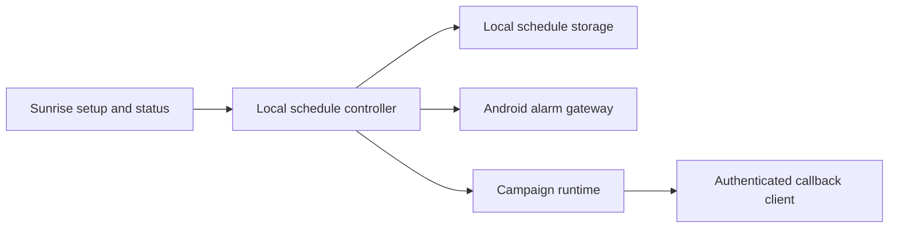

# Sunrise P1 implementation and acceptance

Reader: The Android maintainer implementing Docket project `01M5AXW727EJSE5FM2H8WXJRWS`.
Action: Complete the local Sunrise journey and collect evidence against all four feature tasks before accepting P1.
Date: October 19, 2026.
Status: Implementation started. No feature or device acceptance is claimed.

## Decision

Keep the existing persistent campaign engine, exact-alarm gateway, Room campaign storage, and authenticated callback protocol. Add a durable local alarm schedule above that engine. Curfew accounts and the coordinator remain optional. The saved schedule describes future mornings; the active campaign identifies one morning and keeps its release authority even when future settings change.

Support one saved Sunrise alarm with either a selected one-night date or selected weekdays. The user can edit its time, recurrence, and enabled state. Disabling future alarms does not dismiss an occurrence that has already begun. The UI shows the saved next occurrence and the active condition. Ringing keeps the existing two-minute ring and one-minute quiet defaults; configuration of engine internals belongs outside the normal nightly flow.

Follow device-local time for future occurrences. Retain the resolver's existing DST behavior: a gap uses the first valid instant and an overlap uses the first offset. An occurrence already underway retains its identity through clock changes and recovery. Repeated delivery of a scheduled occurrence must not reset its active state. A completed one-night occurrence must never become tomorrow's recurring alarm.

The release verifier must have a usable shared-secret provisioning path. Merely saving a URL and generating an inaccessible secret is incomplete. The setup UI must display success only after persistence succeeds and expose supported provisioning without logging secrets. An unavailable verifier leaves the alarm active. Emergency owner recovery records an override rather than a verified wake.

## Component diagram

This component diagram shows modules within the Android application. The schedule controller coordinates future occurrences. The existing campaign engine governs active ringing and release.

## Implementation sequence

### P1.1: Durable schedule and armed state

- [ ] Run the existing plain unit suite before changes.
- [x] Add failing schedule tests for a one-night date, selected weekdays, disabled state, next-day recurrence, DST gap/overlap, and stable occurrence identity across recovery.
- [x] Add `alarm/SunriseSchedule.kt` for local schedule selection and deterministic occurrence identity. Keep it independent of Android so these cases run as host tests.
- [x] Add a tested controller that replaces only future scheduled state, rejects incomplete readiness/release configuration, preserves active state, and does not duplicate an occurrence on repeated reconciliation.
- [x] Persist the schedule locally and wire it to setup, armed-state display, transition delivery, and recovery. Add persistence and Compose instrumentation coverage.
- [x] Run targeted tests, then the full plain unit suite before accepting the behavior.

### P1.2: Persistent audible execution

- [ ] Audit playback, notification fallback, audio focus, and service redelivery against the saved authoritative campaign.
- [ ] Reproduce each missing behavior in a failing unit or instrumented test before changing production code.
- [ ] Restore an active alarm from saved state without invented campaign parameters or a silent interval until the next attempt.
- [ ] Verify the installed locked-screen and denied-full-screen paths on an emulator, and retain physical audio/device checks as separate evidence.

### P1.3: Authenticated release

- [x] Add failing tests for configuration/provisioning, accurate save status, and current-occurrence-only completion.
- [ ] Complete a controlled HTTPS verifier setup using the existing versioned protocol. Never introduce an Android-only wire shape.
- [ ] Verify pending, malformed, stale, future, replayed, wrong-occurrence, and unreachable responses remain active.
- [ ] Verify a valid response stops the corresponding audio and records the outcome. Keep deliberate recovery distinct.

### P1.4: Recovery and acceptance

- [ ] Exercise process death, relaunch, reboot, package replacement, time/zone changes, permission revocation, and offline ringing.
- [x] Run both distribution unit/lint/build checks with at most two Gradle workers.
- [ ] Run installed instrumentation and collect screenshots of the final setup and ringing states.
- [ ] Record a Pixel and a non-Pixel acceptance run, including actual audio, Doze, DND, focus changes, and manufacturer limits. Do not substitute emulator evidence.
- [ ] Update Docket through its connector as Codex, then complete only tasks whose acceptance criteria have direct evidence.

## Verification ledger

The starting revision is remote main `6c7062c`. The primary checkout is diverged and contains unrelated work; implementation uses `codex/sunrise-p1` in an isolated worktree. The shared-cache bootstrap completed. The documented resource checker is missing at `~/.claude/resource-limits/agentctl`; Gradle commands are bounded with `--max-workers=2` and `--no-daemon`.

The initial ADB inventory and mDNS discovery contain no connected devices. Six emulator profiles exist. Physical-device acceptance remains unproven.

The focused host run uses the cached Kotlin 2.4.10 compiler and JUnit 4.13.2 with Corretto 20, targeting JVM 17. It passes 23 tests across `SunriseScheduleTest`, `SunriseSchedulePlannerTest`, and the existing `WakeScheduleResolverTest`. New types first failed compilation because their APIs did not exist. The overdue-disable regression then failed with an actual assertion: the planner returned no occurrence instead of preserving the due morning. That assertion passed after the guard changed. These results prove domain behavior, not Android integration, storage, audio, lint, or an installed build.

`SunriseSchedulePlanner` preserves an active or overdue morning when future settings change, cancels a disabled future occurrence, and carries the completed local date into the next plan. The storage adapter must persist that completed date so a later clock rewind cannot reopen it. The setup screen now uses the saved schedule model. It offers native time/date selection, weekly day selection, and the saved next occurrence. The ringing screen observes persisted campaign state. These integrations have compiled, but installed UI acceptance remains pending.

The pinned Gradle 9.5 distribution finished downloading. The host default Java is 27, so its initial build was stopped before compilation; the first full unit run used Android Studio's Java 25 and cached Gradle 9.6.1. The current run uses pinned Gradle 9.5 with two workers and a 1 GiB heap. An offline probe identified six uncached Android build artifacts. The online run resolved those artifacts. The first full plain unit run with Gradle 9.6.1 passed 95 tests across 22 suites using the pinned DataStore 1.2.1 dependency. A subsequent build compiled production and instrumentation Kotlin before failing on the intentionally absent release-consumption API. The implementation now includes that API. The Gradle 9.5 wrapper run with Java 25 passed: 104 plain unit tests across 23 suites, zero failures and errors, plus app and instrumentation APK assembly. GMS verification, both lint checks, and installed checks remain required.

Protocol tag `v0.3.0` could not be fetched, and a remote tag query for `*0.3*` returned none. CI currently references that absent tag. Local testing uses the existing clean protocol checkout at immutable revision `6f5372d67d074a0a88c13b42499940ed3639936e`; it does not claim a tagged or published protocol release. No wire shapes changed in this work.

## Rollback

Keep the previous saved schedule until a replacement can be scheduled. Preserve active campaign state when editing future settings. A bad setup or unavailable verifier must not be reported as armed or released. Retain an explicit owner-recovery procedure and record its override outcome. Production signing and network integration are outside this change.

## Release and playback follow-up

Release consumption now checks the matching campaign's terminal state and durably clears only that occurrence. It advances the completed local date before trying the next morning. Duplicate approval cannot consume a newer occurrence. An active runtime cannot be consumed. Three failing compilation regressions established the missing API before implementation. The callback worker now stops local playback and reconciles the local schedule before optional account publication. Boot and clock recovery also reconcile the saved schedule; a readiness failure for the next morning must not prevent restoration of an active campaign.

Playback service inspection found that stale start intents can ring after terminal state and sticky process restart stops rather than immediately restoring authoritative state. Six regression tests cover saved active attempts, quiet boundaries, future schedules, unmatched campaign IDs, terminal results, and selecting the most recently persisted active campaign. The focused host suite now passes 63 tests, including those six and the three release-consumption tests. The service now uses this recovery decision before audio and observes durable campaign state. Installed service behavior remains unverified. This focused runner uses cached DataStore 1.0.0; the earlier 95-test Gradle run used the pinned 1.2.1 version. The Gradle 9.5 wrapper subsequently passed all 104 plain unit tests against pinned dependencies and assembled both APKs. These results still do not establish installed behavior or physical audio.

The Docket connector returned `MCP authentication required` during the current task refresh. Local implementation continues. No task acceptance or new progress publication is claimed for this disconnected interval.

The isolated API 35 emulator (`Sunrise_API35`, emulator-5554) booted and installed both APKs. The first six-test instrumentation run passed the two schedule-edit tests and all three Room tests. One assertion failed because Compose's `assertTextContains` defaults to whole-text matching; the expected warning was present in the failure's semantics dump. The test now requests substring matching explicitly. A rebuilt test APK and rerun remain required. This emulator has host audio disabled and supplies no physical sound evidence.

The installed MainActivity rendered the initial Sunrise setup with time, one-night/weekly choices, date, missing-condition warning, disabled Save, and readiness status. The inspected screenshot is `build/sunrise-evidence/setup-api35.png`. The isolated emulator was then shut down successfully before the combined Gradle plain/GMS unit, lint, and APK run. That run uses one worker and a 1 GiB heap. The corrected instrumentation assertion still requires a rebuilt APK and installed rerun.

## Verifier setup progress

The selected condition now carries a separate persisted verification marker. A newly saved or replacement condition is unverified. A late connection test cannot verify a different selected condition. Sunrise checks this marker and the stored definition before arming. Existing active occurrences retain their original callback identity.

The setup controller supports reading the selected stored protocol definition for explicit export. Android's document picker writes that definition, including its private signing key, only to the owner-selected destination. The app does not log or copy it to the clipboard. Keep the exported file private and install it on the trusted verifier. A connection test uses the existing signed callback exchange with a fresh, non-persisted UUID. Either authenticated receipt status establishes connectivity; it cannot complete a saved occurrence. Saving reports success only after both storage and selection succeed.

New controller/provisioning/readiness tests first failed compilation on the missing APIs. The new Compose setup test first failed compilation on the missing card. Both distributions' unit, lint, and APK checks are running after implementation. Installed export, signed verifier, and audible release acceptance are still pending.

The current setup build passed 120 plain and 120 GMS unit tests across 26 suites with zero failures or errors. Plain lint passed with zero errors. GMS lint caught a transitive Fragment version below the activity-result minimum when compiling the export picker. Dependency correction and a complete rerun are required before accepting the new APKs. This is a build gate, not a reason to suppress the lint check.

The latest actual Android workflow run (`37079938046`, October 2) failed during SDK setup because the action requested the removed `tools` package. The action's published v3 manifest still defaults to `tools platform-tools`. Every setup invocation now explicitly requests only `platform-tools`; existing compile SDK installation and emulator provisioning remain explicit. This corrects the observed failure without suppressing SDK checks. Remote CI is not yet verified, and its separate missing `v0.3.0` protocol checkout tag remains unresolved. Dependabot update jobs do not count as Android verification.

The Fragment dependency report confirmed version 1.1.0 arrives through Firebase's Play Services base/basement dependencies. A GMS-only constraint now selects Fragment 1.9.1, the current stable release listed by Android Developers. The complete rerun passed 120 unit tests per distribution, both lint checks, all three requested APK assemblies, and `verifyPlainRuntimeIsolation`. Gradle reported `BUILD SUCCESSFUL`; the isolation task intentionally discards its incompatible configuration-cache entry. The emulator rerun is the next acceptance step. Lint retains dependency-update and existing source/resource warnings; it has zero errors.

The rebuilt API 35 instrumentation run executed 14 tests. It found an outdated keyguard fixture that expected a raw launcher boolean without a saved campaign to wake the screen. The updated test persists a real active campaign, waits for asynchronous recovery, and separately verifies that a missing campaign cannot request keyguard presentation. The callback-card, schedule, and Room checks passed in that run. The corrected full installed rerun is required.

The corrected API 35 full instrumentation run passed all 15 tests in 35.361 seconds. This includes the schedule and wake-condition Compose checks, Room/Keystore/manifest checks, the ringing control, and saved-active versus missing-campaign keyguard presentation. The isolated emulator has host audio disabled; this result supplies no physical sound evidence.

Installed setup verification also saved `P1 test condition` against an intentionally unreachable `.test` endpoint. Android's document picker exported its generated protocol definition to Downloads. A local check confirmed its identity, endpoint, poll policy, and 32-byte key without printing key contents. The test export was deleted. Testing that unreachable endpoint left the condition unverified and showed the failure. No alarm was armed during this setup check. Captures are under `build/sunrise-evidence/`, including `setup-current-api35.png` and `condition-rejected-api35.png`.

The next required work is the controlled HTTPS verifier-to-audio release journey, callback poll-chain and persisted-state concurrency, deliberate owner recovery, lifecycle/reconnection acceptance, protocol CI reference resolution, and physical Pixel/non-Pixel checks. None of those requirements is waived by the successful setup/build/instrumentation checks above.
