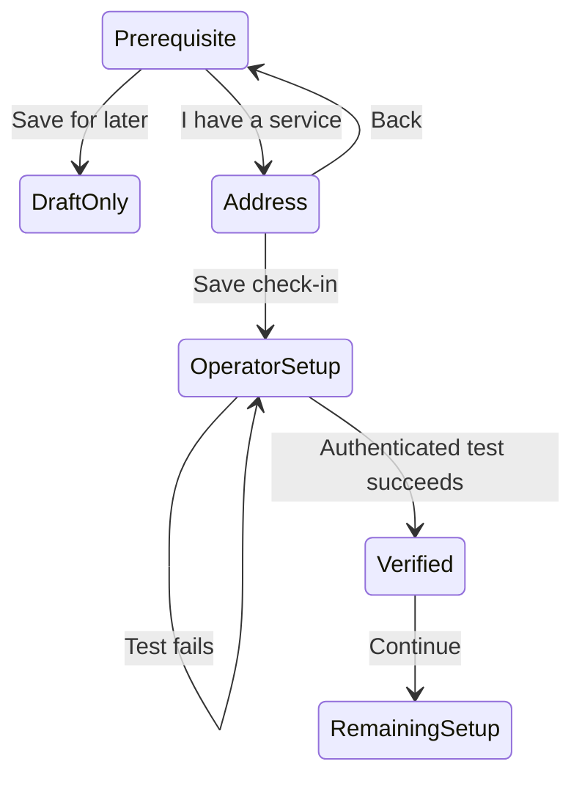

# Check-in prerequisites and consumer launch blocker

Reader: The Android designer and maintainer.
Action: Stop presenting the custom-service integration as a complete consumer setup path.

The current app supplies authenticated alarm release but no consumer service
that grants it. A user must already know an operator who runs a compatible
HTTPS service. That operator needs the phone's private setup file. An ordinary
website URL cannot satisfy this requirement. The previous visual acceptance
did not establish that a consumer could complete setup.

Keep the working integration and its security contract. State its prerequisite
before the form. Give users without a service a clear Save for later action.
Retain their wake-time draft and keep the alarm disabled. Use a secondary
I have a service action for the advanced connection. Explain the operator's
role where the user enters the address and transfers the file. Keep testing
available for operators who already have the file. Do not imply that saving
the address or file proves a connection.

On compact windows, measure the introduction and actions as one group and
center that group when it fits. Overflow must scroll. Preserve the two-pane
and hinge-aware arrangements. Do not add copy or decorative panels to fill
space.

The consumer release method remains a launch blocker. The intended first
consumer method is trusted-person approval, consistent with the owner's
delegated-release direction. That requires a real invitation, approval surface,
authorization, and recovery flow. None exists in this Android change. Do not
advertise that method or substitute ordinary dismissal.

This state diagram covers the current supported integration.

The existing alarm activation gate continues to require a verified connection
and Android readiness. No protocol or release semantics change. Reverting the
UI change does not change stored schedules or callbacks.

The implementation uses existing Compose and Material components.

- [x] Add and observe failing native tests for the explicit prerequisite, operator handoff, draft deferral, and compact grouping.
- [x] Correct the check-in screens and compact task arrangement.
- [x] Update affected navigation/capture selectors and retain callback/security regressions.
- [x] Run both host suites, both Android lint/build variants, and focused native tests.
- [x] Capture and inspect the full phone/tablet/fold-cover/fold-inner matrix in both orientations/themes and enlarged text.
- [x] Record the result and the unresolved consumer launch blocker in design and acceptance documentation.
