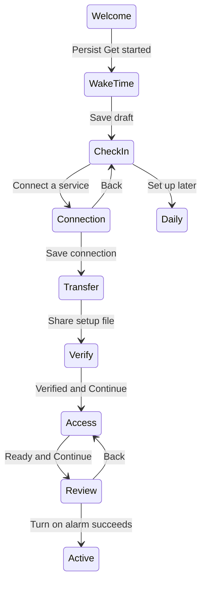

# Android setup repair

The Android maintainer should use this plan to repair setup before reviewing the next build. The reader must distinguish setup drafts from enabled alarms and connection setup from a verified release condition.

We retain Navigation 3 and the existing authenticated service contract. We fix ownership of saved setup state and give each setup step a clear purpose and action. No new release method, account dependency, or network protocol belongs in this change.

## State and navigation

The current flow saves its route but holds its draft only in memory. Restoring Review can therefore produce an empty screen. Readiness also advances on entry, which sends Back from Review forward again. Welcome advances before the first-use choice is durable. Main starts navigation with fabricated empty preferences and a not-yet-loaded connection label.

Save the draft with navigation state. Keep transient operation flags transient. Resume with a meaningful Back path to the editor. Advance readiness through an explicit Continue action. Await welcome persistence and retain the welcome on failure. Wait for loaded preferences and connection identity before choosing a cold-start route. Back from a connection form first returns to its introduction. Deferring setup preserves the draft and never enables an alarm.

## Consumer interaction

Check-in starts with its purpose: it confirms when the alarm may stop. State the real prerequisite once: a compatible service and its connection address. Show the manual form only after Connect a service. Keep the optional opening link behind optional details. After saving, show setup-file transfer and testing as distinct steps. Never imply a test succeeded after saving or exporting alone.

A common adaptive task arrangement places purpose and work in distinct regions when width permits. Compact screens place content above a reachable primary action. Short windows, the keyboard, and enlarged text use scrolling rather than clipping. Use existing MD3 components, theme colors, and actual content rather than filler cards.

The wake-time summary retains the same shared bounds across daily, editor, and review. A real connection summary can share its bounds with Review. Unrelated permission steps use directional screen motion. The design must respect the system animation scale.

## Implementation and verification

- [x] Add native regressions for the navigation loop, restored review draft, resumed Back path, welcome write failure, setup deferral, form Back, restored operation state, and settings return.
- [x] Observe failures before changing production code.
- [x] Repair state ownership and loading order.
- [x] Replace immediate manual check-in fields with introduction, connection, transfer, and test states.
- [x] Verify service binding and validation without weakening authenticated release.
- [x] Adapt task layouts and shared transitions.
- [x] Run both host distributions, lint, app builds, and relevant native suites.
- [x] Capture and inspect phone, tablet, fold cover, and fold inner windows in both orientations and themes plus narrow enlarged text.
- [x] Record failures and gaps, update acceptance documentation, and commit the reviewed change.

## State transition diagram

The diagram shows the sequential case where every setup step is needed. Already verified connections and completed access skip their respective steps on forward navigation. They do not cause Back to advance again. Cold resume rebuilds a Back path to the saved time.

## Boundaries and rollback

The current service connection requires manual configuration. A provider catalog, QR provisioning, keyholder setup, and cross-device release require separate product and protocol work. Do not fabricate them. Existing saved alarm binding must stay truthful when the selected connection changes. Physical Pixel Doze acceptance remains a separate open gate. Reverting this change restores the previous UI without changing stored alarm or callback formats.
